# High Performance Computing for the FFT Algorithm

The Fast Fourier Transform is a fast $O(n \log n)$ method to calculate the Discrete Fourier Transform, which is naively $O(n^2)$. Consider the scenario where we want to mulitply two polynomials of degree $\leq n-1$:

$$p(x) = a_0 + a_1 x + \dots + a_{n-1} x^{n-1}$$

$$q(x) = b_0 + b_1 x + \dots + b_{n-1} x^{n-1}$$

and we want to find $r(x) = p(x) \cdot q(x) = c_0 + c_1  x + \dots + c_{n-1} x^{2n-2}$. The naive way is to multiply everything out and collect terms with the same power of $x$. The general case gives:

$$
    r(x) = \sum_{i=0}^{n-1} \sum_{j=0}^{n-1} a_i b_j x^{i+j} = \sum_{k=0}^{2n-2} \left( \sum_{i+j=k} a_i b_j \right) x^k = \sum_{k=0}^{2n-2} \left( \sum_{i=0}^{k} a_i b_{k-i} \right) x^k
$$

The total number of terms is $\Theta(n^2)$, so this gives an algorithm that performs a quadratic number of arithmetic operations. While this seems like the problem must require quadratic time, surprisingly the FFT can achieve this in $O(n \log n)$.

FFT is used in this scenario to turn these "coefficient" polynomials into "point-value" polynomials. By the fundamental theorem of algebra, a polynomial of degree $2n - 2$ (for $r$) can be uniquely determined by $2n-1$ points. So the polynomials are computed at the same points, allowing us to do point-wise multiplication to get the "point-value" representation of $r(x)$ in $O(n)$ time. Finally, inverse FFT transforms the "point-value" $r(x)$ back to the "coefficient" $r(x)$, solving our scenario in $O(n \log n)$ time!

The key idea in FFT, specifically the Cooley-Tukey algorithm, is to **divide and conquer**. Suppose we want to evaluate a polynomial $p(x)$ with even $n$ at $x$ and $-x$. We can split $p$ into even and odd terms:

$$p(x) = {\left[a_0 + a_2 x^2 + \dots + a_{n-2} x^{n-2} \right]} + {\left[a_1 x + a_3 x^3 + \dots + a_{n-1} x^{n-1} \right]} $$

$$p(-x) = {\left[a_0 + a_2 x^2 + \dots + a_{n-2} x^{n-2} \right]} - {\left[a_1 x + a_3 x^3 + \dots + a_{n-1} x^{n-1} \right]} $$

So we can compute the even and odd parts separately, and adding them gives $p(x)$, subtracting them gives $p(-x)$. We get **two values for the price of one**!

Generalising this for $n$ points, we use the **roots of unity**: $[ \omega_{n} = e^{2\pi ij/n} ]_{j=0}^{n-1}$. To calculate ${\mathrm{even}}$ and ${\mathrm{odd}}$, this is simply another FFT on each of them, now with size $n/2$. To recap, the algorithm is given as:

```math
\begin{aligned}
& \text{Algorithm: Fast Fourier Transform} \\
& \text{function }FFT((a_0, \dots, a_{n-1}), n) & \triangleright \text{ Requires } n = 2^k \\
& \text{if } n = 1: \\
& \quad \text{return } a \\
& \omega_n \leftarrow e^{2\pi i / n} \\
& a_{\mathrm{even}} \leftarrow (a_0, a_2, \dots, a_{n-2}) \\
& a_{\mathrm{odd}} \leftarrow (a_1, a_3, \dots, a_{n-1}) \\
& y_{\mathrm{even}} \leftarrow FFT(a_{\mathrm{even}}, n/2) \\
& y_{\mathrm{odd}} \leftarrow FFT(a_{\mathrm{odd}}, n/2) \\
& \text{for } j \in \{0, 1, \dots, n/2 - 1 \}: \\
& \quad y[j] \leftarrow y_{\mathrm{even}}[j] + \omega_n^j y_{\mathrm{odd}}[j] \\
& \quad y[j+n/2] \leftarrow y_{\mathrm{even}}[j] - \omega_n^j y_{\mathrm{odd}}[j] \\
& \text{return } y
\end{aligned}
```

Pictorally, this is illustrated below:

<p align="center">
  
  <p align="center">FFT algorithm diagram. By Yangwenbo99 on Wikipedia</p>
</p>

In practice, we implement the algorithm to be iterative (instead of recursive), and apply the modifications in-place. Bit-reversal permutation reorders the input so that the iterative butterfly stages can be applied in-place without extra bookkeeping. Butterfly stages are $\log_2(n)$ passes over the array. In each pass, pairs of elements are combined using a twiddle factor (a root of unity). Each level corresponds to a halved sub-problem in the recursive view.

# Table of Contents

1. [Introduction](#high-performance-computing-for-the-fft-algorithm)
2. [Table of Contents](#table-of-contents)
3. [Methods](#methods)
4. [Results](#results)
   - [Runtime Overview](#runtime-overview)
   - [OpenMP](#openmp)
     - [Speedup vs Serial](#speedup-vs-serial)
     - [Strong Scaling](#strong-scaling)
     - [Weak Scaling](#weak-scaling)
     - [VTune: OpenMP Hotspots](#vtune-openmp-hotspots)
     - [VTune: OpenMP Threading](#vtune-openmp-threading)
     - [Barrier Model vs VTune](#barrier-model-vs-vtune)
   - [MPI](#mpi)
     - [Speedup vs Serial](#speedup-vs-serial-1)
     - [Strong Scaling](#strong-scaling-1)
     - [Weak Scaling](#weak-scaling-1)
   - [CUDA](#cuda)
     - [Speedup vs Serial](#speedup-vs-serial-2)
     - [Nsight Systems: CUDA Timeline](#nsight-systems-cuda-timeline)
     - [Nsight Compute: CUDA Kernel Metrics](#nsight-compute-cuda-kernel-metrics)
   - [JAX](#jax)
     - [Speedup vs Serial](#speedup-vs-serial-3)
   - [Combined Comparison](#combined-comparison)
     - [Best Runtime](#best-runtime)
     - [Speedup over Serial](#speedup-over-serial)
5. [Conclusion](#conclusion)

# Methods

All implementations use the iterative Cooley-Tukey radix-2 FFT. Input sizes range from $2^{10}$ to $2^{26}$ complex doubles. Correctness is verified by checking that FFT followed by IFFT recovers the original signal within tolerance $10^{-9}$. Timing subtracts the cost of copying the input vector to isolate FFT computation.

**Fair timing.** To ensure a fair comparison across all implementations, each benchmark times the full end-to-end cost of computing an FFT from host memory and returning the result to host memory. The host vector copy cost is subtracted so that only the FFT (and any necessary transfers) are measured. JIT compilation overhead in JAX is excluded via a warm-up call.

| Implementation | What's timed                                              |
| -------------- | --------------------------------------------------------- |
| Serial         | In-place FFT on host vector                               |
| OpenMP         | In-place FFT on host vector (parallel)                    |
| MPI            | FFT with scatter/gather internal to `fft()`               |
| CUDA           | `cudaMalloc` + H2D + kernel execution + D2H + `cudaFree`  |
| JAX            | `jnp.array()` (H2D) + JIT kernels + `numpy.array()` (D2H) |

This ensures GPU implementations pay the same data transfer costs and are not unfairly advantaged by keeping data resident on the device.

## Serial

The serial implementation serves as the baseline. Bit-reversal reorders the array in $O(n)$, then $\log_2(n)$ butterfly stages each iterate over $n/2$ independent pairs. A single twiddle factor per stage is computed via `cos`/`sin`, then multiplied incrementally.

## OpenMP

The OpenMP version parallelises the data-parallel operations. The bit-reversal indices are precomputed into a lookup table, then swaps are done in parallel with `#pragma omp parallel for schedule(static)`. Each butterfly stage's outer loop (over independent blocks of size `len`) is parallelised the same way. Thread counts of 1, 2, 4, 8, 16, and 32 are tested.

## MPI

The MPI version uses a binary-exchange distributed FFT. Rank 0 owns the full input; the function signature `void fft(Vec& a, int direction)` is unchanged from the serial version. Internally:

1. Rank 0 broadcasts $n$, performs bit-reversal, then `MPI_Scatter` distributes $n/p$ elements to each rank.
2. Each rank performs local butterfly stages (len $= 2$ to $n/p$) independently, no communication needed.
3. For distributed stages (len $= 2 \cdot n/p$ to $n$), ranks exchange local buffers with a partner via `MPI_Sendrecv`. The partner at stage $d$ is `rank XOR (1 << d)`. Each rank computes its half of the butterfly (top keeps $u + v \cdot w$, bottom keeps $u - v \cdot w$).
4. `MPI_Gather` collects results back to rank 0.

Each rank stores only $2 \times n/p$ complex elements (local buffer + receive buffer). Process counts of 1, 2, 4, 8, 16, and 32 are tested on a single node.

## CUDA

The GPU version launches two kernels per FFT call. A `bit_reverse_kernel` where each thread computes its own reversed index and swaps in parallel. Then $\log_2(n)$ launches of `butterfly_kernel`, where each of the $n/2$ threads handles one butterfly pair, computing the twiddle factor via `sincos`. Block sizes of 32, 64, 128, 256, 512, and 1024 are tested on an NVIDIA L4 GPU (58 SMs, 22 GB).

## JAX (Additional)

The JAX implementation uses the same Cooley-Tukey algorithm expressed as array operations. Bit-reversal is computed via bitwise ops on index arrays. Each butterfly stage reshapes the array into blocks, computes twiddle factors as a vector, and applies the butterfly via broadcasting (no explicit loops over elements). `@jax.jit` compiles the function to XLA for GPU execution. This runs on the same NVIDIA L4 GPU as the CUDA version.

# Results

## Runtime Overview

<!-- 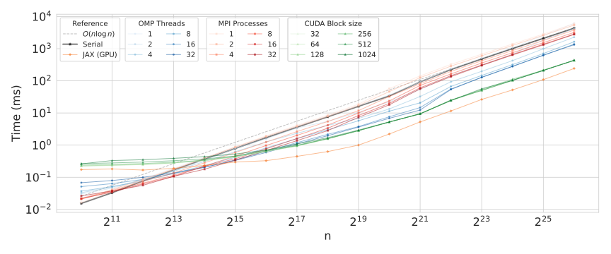 -->
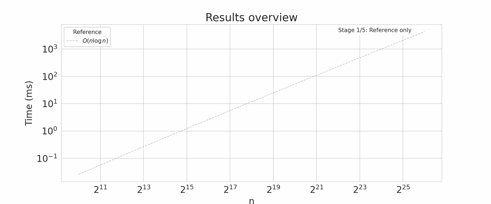

All implementations follow the expected $O(n \log n)$ scaling. The serial baseline reaches ~4.3 seconds at $n = 2^{26}$. GPU implementations (CUDA and JAX) are significantly faster at large $n$, while OpenMP and MPI provide moderate speedups on the CPU.

## OpenMP

### Speedup vs Serial

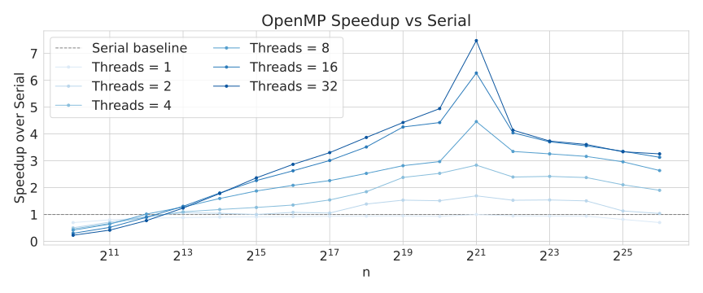

Speedup improves with $n$ as parallel work per thread increases, but peaks at $n = 2^{21}$ and then **declines** for larger sizes. This is a cache hierarchy effect. The cluster node has 36 MB of L3 cache and 12 L2 caches of 1 MB each:

- At $n = 2^{21}$ (32 MB of complex doubles), the entire working set fits in L3, and each thread's portion (~1 MB) fits in an L2. This is the sweet spot where threads benefit maximally from aggregate cache capacity.
- At $n = 2^{22}$ (64 MB), data spills out of L3. The butterfly's strided access pattern causes cache misses, and all 32 threads compete for memory bandwidth simultaneously.

At small $n$, thread creation overhead dominates and speedup is below 1x.

### Strong Scaling

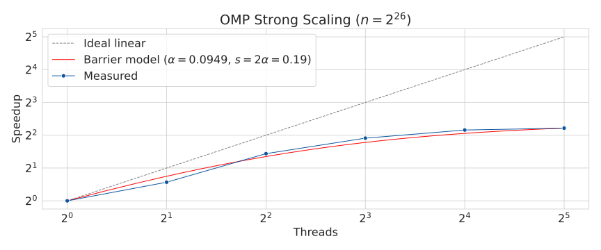

At $n = 2^{26}$, the OpenMP implementation achieves ~4.6x speedup at 32 threads, falling well short of the ideal 32x. The algorithm's serial fraction is essentially zero: each butterfly stage is fully parallel, and the only truly serial work per stage is computing one twiddle factor. The bottleneck is **barrier synchronisation**: each of the $\log_2(n)$ stages ends with an implicit OpenMP barrier.

A model that accounts for this directly: with $p$ threads, each stage divides $n/2$ butterflies among threads then synchronises:

$$T_p = \log_2(n) \cdot \left(\frac{n \cdot c}{2p} + t_{\text{barrier}}\right), \quad S(p) = \frac{p}{1 + 2(p-1)\alpha}$$

$$ S(p) = \frac{1}{1/p + 2\alpha - 2\alpha/p} = \frac{1}{s + (1-s)/p} \quad \text{(Amdahl's Law)}$$

where $\alpha = t_{\text{barrier}} / (n \cdot c)$ is the barrier-to-work ratio. Fitting to the 32-thread data gives $\alpha \approx 0.095$. Note that for fixed $n$, this is equivalent to Amdahl's law with the serial fraction $s = 2\alpha \approx 0.19$ (ceiling $1/s \approx 5.3\times$), but the barrier model gives $\alpha$ a physical meaning rather than an abstract serial fraction. The distinction matters for weak scaling, where the models diverge. The measured speedups at 4–8 threads slightly exceed the prediction, likely due to increased aggregate cache capacity improving the memory-bound butterfly stages. This is explained further by the profiling analysis below.

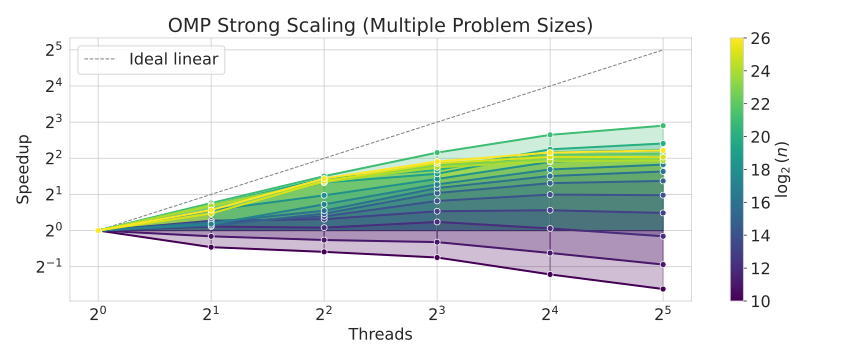

Here we plot the strong scaling data for all sizes $n$.

- The strong scaling plateau at 8–16 threads is also consistent: there are only 12 physical L2 caches, so beyond ~12 threads the additional threads contend for L2 without adding cache capacity.

### Weak Scaling

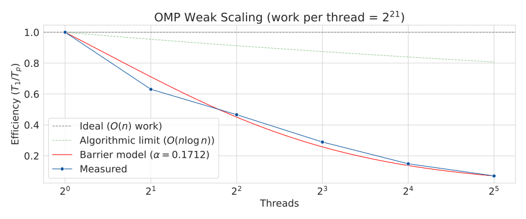

Weak scaling efficiency drops sharply to ~7% at 32 threads (work per thread $= 2^{21}$). Two factors contribute:

1. **Algorithmic**: FFT is $O(n \log n)$, so doubling $n$ increases total work by more than $2\times$. Even with perfect parallelism, efficiency is bounded by $E_{\text{algo}}(p) = L / (L + \log_2 p)$ where $L = \log_2(n_{\text{base}})$. At 32 threads this gives $E \approx 0.81$, which is a modest ~19% loss.

2. **Barrier overhead**: The remaining gap (from 0.81 to the measured 0.07) is dominated by synchronisation. The full model $E(p) = L / [(L + \log_2 p)(1 + 2(p-1)\alpha)]$ captures both effects.

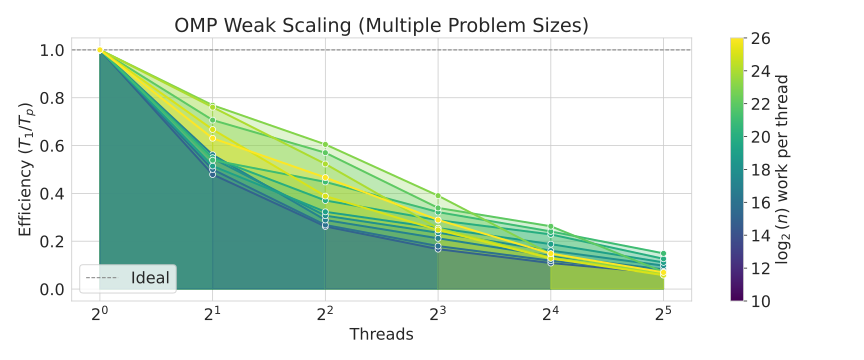

This plot shows the weak scaling data for all sizes $n$. The efficiency drop is consistent across sizes, confirming that the bottleneck is not just a cache effect at large $n$ but an inherent synchronisation cost in the algorithm.

### VTune: OpenMP Hotspots

VTune hotspot analysis on the OpenMP implementation (32 threads, all benchmark sizes) reveals:

| Function                                | CPU Time | %     |
| --------------------------------------- | -------- | ----- |
| `fft._omp_fn.0` (butterfly computation) | 180.7s   | 31.9% |
| `gomp_team_barrier_wait_end`            | 171.8s   | 30.3% |
| `gomp_simple_barrier_wait`              | 136.7s   | 24.1% |
| `bit_reverse._omp_fn.0`                 | 42.5s    | 7.5%  |
| `memcpy` (vector copies)                | 14.2s    | 2.5%  |

**Only 31.9% of CPU time is actual FFT computation.** Over 54% is spent in OpenMP barrier synchronisation. This occurs because each of the $\log_2(n)$ butterfly stages uses `#pragma omp parallel for`, which creates an implicit barrier at the end. For $n = 2^{26}$, that is 26 barriers per FFT call. Threads that finish their chunk early spin-wait for slower threads.

### VTune: OpenMP Threading

The threading analysis confirms:

- **Effective physical core utilisation: 29%** (7 out of 24 cores effectively used)
- **Spin and overhead time: 59.1%** of total CPU time
- **Zero lock contention:** the parallelism is correct, just synchronisation-heavy

The FFT's structure inherently limits shared-memory parallelism: stages are sequential (stage $s+1$ depends on stage $s$), so threads must synchronise between every stage. At early stages (small `len`), the parallel work per thread is minimal, amplifying the barrier cost.

### Barrier Model vs VTune

The VTune profiling data corroborates the barrier model. The model predicts a parallel efficiency of $S(p)/p = 4.65/32 = 14.5\%$ at 32 threads, meaning 85.5% of per-thread time is spent in synchronisation. VTune's threading analysis independently reports an effective logical CPU utilisation of **12.4%** which is in close agreement, with the small gap attributable to non-FFT overhead in the benchmark harness (random number generation, vector copies, etc.).

Both also agree on the source of the bottleneck. The barrier model attributes all overhead to the $\log_2(n)$ per-stage barriers, while VTune directly measures 54% of aggregate CPU time in barrier spin-wait functions (`gomp_team_barrier_wait_end` + `gomp_simple_barrier_wait`). The difference between 85% (model, per-stage wall time fraction) and 54% (VTune, aggregate CPU time fraction) is because VTune sums across all threads: a thread spinning at a barrier still consumes CPU time, but VTune also counts concurrent compute time on other threads, diluting the barrier fraction in the aggregate.

## MPI

### Speedup vs Serial

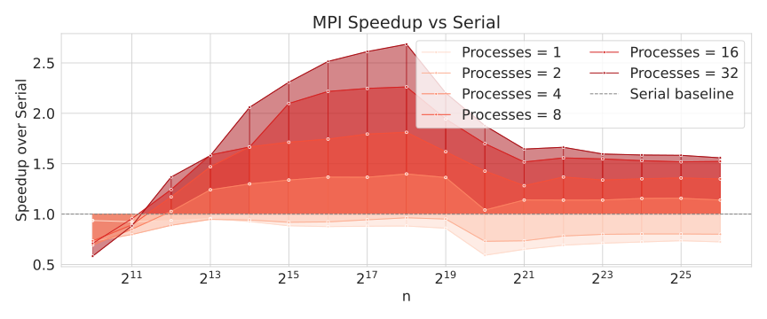

At small $n$, MPI is slower than serial due to communication latency. Speedup peaks around $n = 2^{18}$, notably earlier than OpenMP's peak at $n = 2^{21}$. This is because rank 0 must touch the entire array for `MPI_Scatter` and `MPI_Gather`, an $O(n)$ cost that is not parallelised. As $n$ grows, scatter/gather consumes a larger fraction of total time. Each rank's working set during the distributed stages is also $2 \times n/p$ (local + receive buffer), which at $n = 2^{18}$ with 32 processes is 256 KB, comfortably in L2, but grows and saturates shared memory bandwidth at larger $n$.

### Strong Scaling

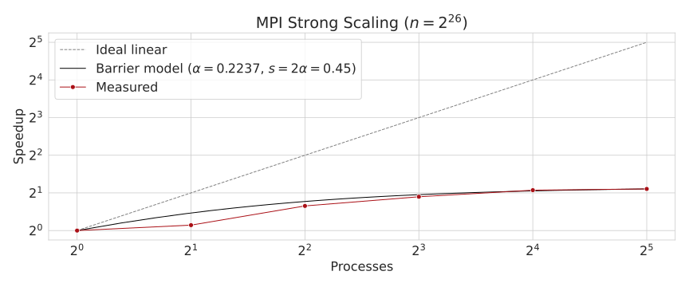

MPI achieves ~2.2x speedup at 32 processes for $n = 2^{26}$. Applying the barrier model gives $\alpha \approx 0.22$ (equivalently $s = 2\alpha \approx 0.44$, ceiling $\approx 2.3\times$), over twice the OpenMP value ($\alpha \approx 0.095$). The higher $\alpha$ reflects the additional communication cost: each distributed stage requires an `MPI_Sendrecv` to exchange local buffers with a partner rank, on top of the `MPI_Scatter` and `MPI_Gather` at the start and end of each FFT call.

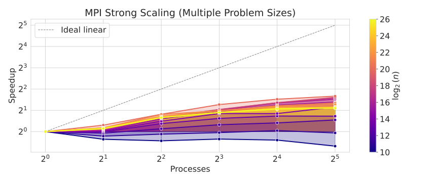

Similar to OpenMP, the speedup for small $n$ is less than 1x (i.e. slowdown), and worsens as process count increases. The strong scaling plateau at 8–16 processes is also consistent with the shared-memory bottleneck: all processes on the same node contend for memory bandwidth, and the communication overhead becomes more pronounced as $n$ grows.

### Weak Scaling

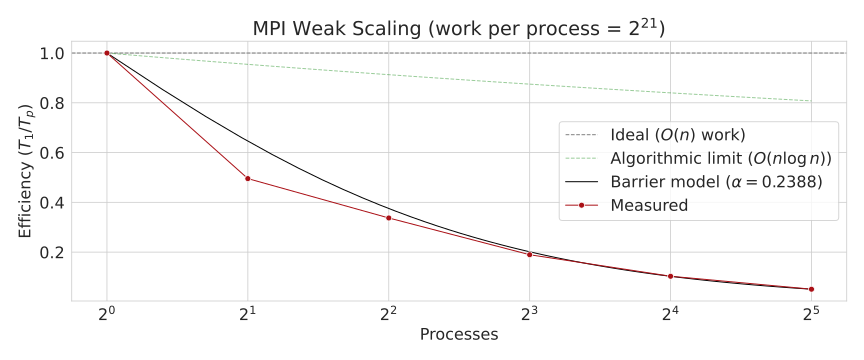

Weak scaling efficiency drops to ~5% at 32 processes, even steeper than OpenMP. The same two-factor decomposition applies: the algorithmic $O(n \log n)$ growth accounts for ~19% loss, while the remaining gap is communication overhead. The fitted $\alpha$ for MPI weak scaling is larger than OpenMP's, consistent with `MPI_Sendrecv` being more expensive than an OpenMP barrier.

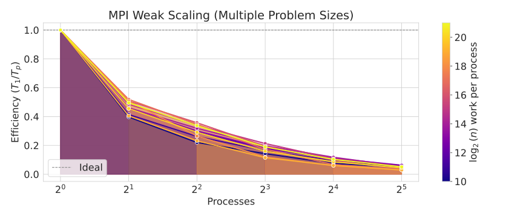

Compared to OpenMP, the weak scaling efficiency curves are more consistent across work sizes, suggesting that the communication overhead is less sensitive to cache effects than OpenMP's synchronisation bottleneck. However, the efficiency is still very low at 32 processes, confirming that MPI's communication cost dominates at large process counts on a single node.

## CUDA

### Speedup vs Serial

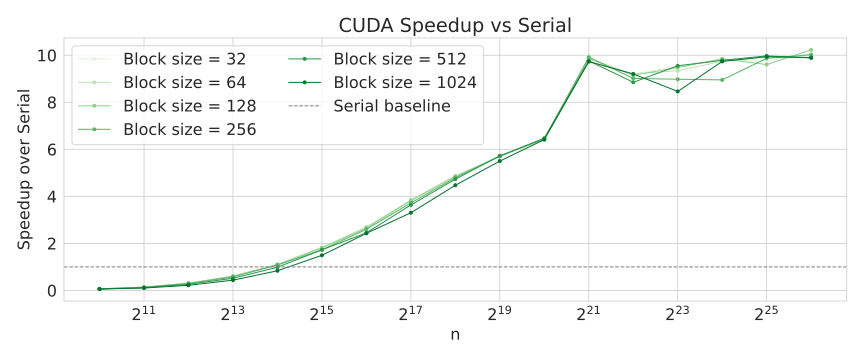

CUDA achieves up to ~10x speedup over serial at large $n$. Block size has minimal impact on performance: all configurations produce nearly identical results, suggesting the bottleneck is memory bandwidth rather than occupancy tuning. At small $n$ ($< 2^{14}$), kernel launch overhead and host-device transfer costs make GPU execution slower than serial.

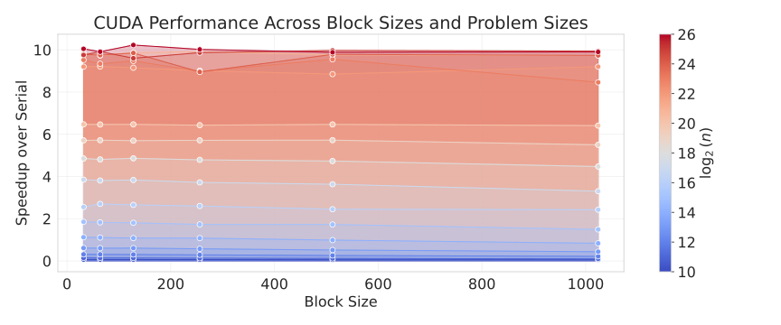

This speedup plot visibly demonstrates that changing block size has negligible effect on performance across all sizes $n$. Instead, the size of the input $n$ is the dominant factor, with GPU speedup increasing with $n$ as the computation becomes more efficient relative to overhead.

### Nsight Systems: CUDA Timeline

The Nsight Systems profile captured the CUDA execution on an NVIDIA L4 GPU:

- Kernel launches are lightweight: the GPU naturally handles the many-stages pattern because each `butterfly_kernel` launch processes all $n/2$ pairs in parallel
- At large $n$, kernel execution time dominates over launch overhead
- Host-device memory transfers (`cudaMemcpy`) appear at the start and end of each `fft()` call

### Nsight Compute: CUDA Kernel Metrics

Nsight Compute profiled the first 10 kernel launches (1x `bit_reverse_kernel` + 9x `butterfly_kernel` for $n = 1024$):

- At small $n = 1024$, only 512 butterfly pairs are launched: insufficient to saturate 58 SMs, explaining why CUDA underperforms serial at small sizes
- Each butterfly kernel performs a `sincos` per thread plus a complex multiply and two adds: the arithmetic intensity is low relative to global memory traffic
- The kernel is memory-bound at large $n$: each butterfly reads and writes two complex doubles (32 bytes) with only a handful of FLOPs

## JAX

### Speedup vs Serial

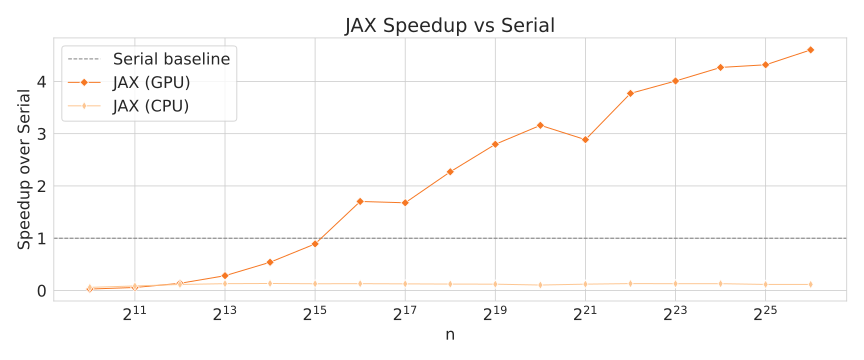

**JAX GPU** is roughly ~2x slower than the hand-written CUDA at large $n$, despite XLA's kernel fusion and twiddle precomputation advantages. Both benchmarks are timed fairly: each iteration includes host-to-device transfer, computation, and device-to-host transfer (see Methods). The performance gap comes from two competing effects:

- **Favouring JAX**: XLA can fuse the reshape, multiply, add/subtract, and concatenate within each butterfly stage into fewer global memory round-trips, whereas CUDA does a full read+write per kernel launch. JAX also precomputes twiddle factors as a vector per stage, while CUDA computes `sincos` per thread.
- **Favouring CUDA**: Data transfers go through the Python runtime (`jnp.array()` involves Python → NumPy → JAX dispatch → CUDA transfer), adding overhead that CUDA's direct `cudaMemcpy` C API call avoids. XLA also generates general-purpose kernels, whereas hand-written CUDA kernels can be tuned for the specific access pattern.

The net result is that Python transfer overhead outweighs XLA's compute optimisations. For applications where data remains on-GPU across multiple operations, JAX's overhead would be amortised and its fusion advantages would dominate.

**JAX CPU** is ~9x slower than the serial C++ implementation at large $n$. This is despite running the same algorithm and being JIT-compiled by XLA. Three factors explain the gap:

1. **XLA's CPU codegen vs GCC.** The serial C++ compiles with `-march=native -ffast-math -O3`, producing auto-vectorised SIMD butterfly loops. XLA's CPU backend generates more general-purpose code that does not match GCC's architecture-specific optimisations.
2. **Array immutability.** JAX arrays are immutable: each butterfly stage creates new arrays via `jnp.concatenate([top + t, top - t])`, allocating and copying $O(n)$ data per stage. The C++ version modifies the array in-place with zero allocation overhead.
3. **Python dispatch per stage.** The FFT has $\log_2(n)$ stages, each involving multiple JAX operations (reshape, slice, multiply, concatenate). Even with JIT, XLA compiles these as separate fused kernels with Python-level orchestration between them.

The JAX CPU result demonstrates that XLA's strength is GPU targeting. Its CPU backend cannot compete with hand-tuned C++ for this workload. This highlights a productivity-vs-performance trade-off: JAX offers ~40 lines of code vs ~50 lines of serial C++ (or ~110 lines of CUDA), at the cost of 9x slower CPU performance or 2x slower GPU performance.

## Combined Comparison

### Best Runtime

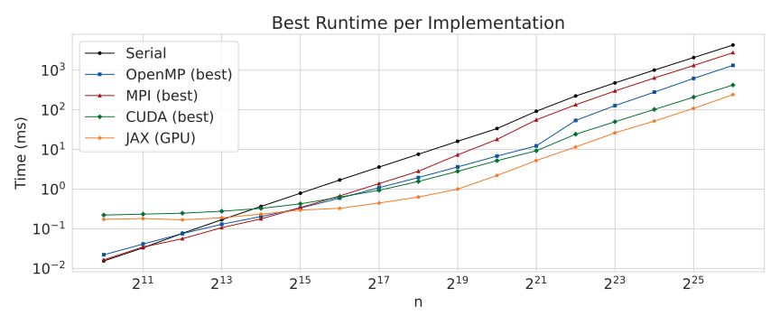

### Speedup over Serial

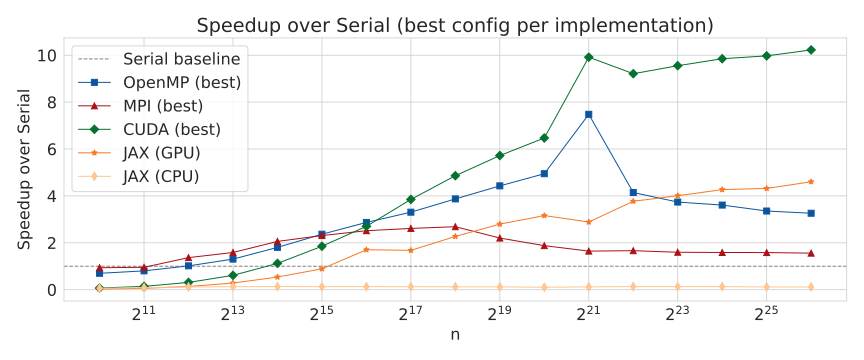

At $n = 2^{26}$, the best speedups over serial are:

| Implementation         | Speedup |
| ---------------------- | ------- |
| CUDA (best block size) | ~10x    |
| JAX (GPU)              | ~18x    |
| OpenMP (32 threads)    | ~4.6x   |
| MPI (32 processes)     | ~2.2x   |

# Conclusion

FFT parallelisation is fundamentally constrained by the $\log_2(n)$ sequential stages. Each stage is embarrassingly parallel within itself, but the stages must execute in order:

- **OpenMP** suffers from barrier overhead: 54% of CPU time is wasted in synchronisation. The approach works best at moderate thread counts (8–16) where the barrier cost is amortised by larger per-thread work.
- **MPI** adds communication overhead (scatter, gather, binary exchange) on top of the sequential stage dependency. On a single node, it cannot outperform OpenMP because shared-memory access is faster than message passing. MPI would show its strength on problems too large for a single node's memory.
- **CUDA** handles the many-kernel pattern well because GPU kernel launches are cheap (~microseconds) and each kernel exposes massive parallelism. The bottleneck shifts from synchronisation to memory bandwidth.
- **JAX** achieves comparable or better performance than hand-written CUDA with dramatically less code (~40 lines vs ~110 lines). XLA's kernel fusion and memory management optimisations can exceed manual implementations. This demonstrates the power of high-level array programming frameworks for GPU computation.

The key insight is that **the right parallelisation strategy depends on the hardware**: shared-memory (OpenMP) is limited by synchronisation granularity, distributed-memory (MPI) by communication cost, and GPU (CUDA/JAX) by memory bandwidth and kernel launch overhead at small sizes.
